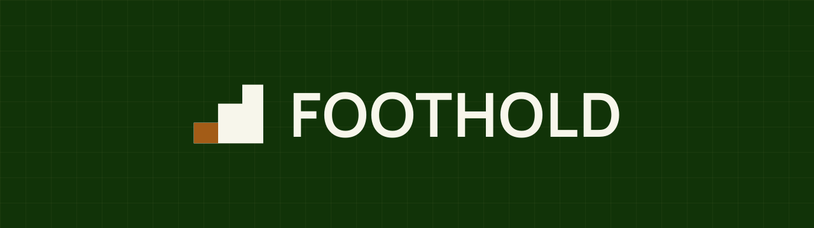

  

# Foothold

A **foothold** is a secure initial position established in enemy or hostile territory. Troops use it as a base to land reinforcements, stockpile supplies, and launch further operations into the area.

For defence-sector founders, the hostile territory is the landscape itself. The MOD reorganises faster than the briefing notes can keep up. The named bodies are a thicket of acronyms (NAD Group, NA-Innov, DASA, FCI, jHub, DCTO, CSOC, IDA). The frameworks have different operators, different routes in, different gatekeepers. The information is public, but it is fragmented across hundreds of gov.uk pages, trade-body briefings, supplier directories, and Hansard transcripts. Months disappear into figuring out what the larger players already know.

Foothold gives you that secure initial position in an evening.

It is an integrated AI operating model and second brain for defence businesses, delivered as an installable Obsidian vault pack. One command lays down the whole thing: folder structure, page templates, skills, and pre-populated open-source defence reference content. Walk into Monday with a knowledge system that already knows where the public frameworks live, which MOD body owns what, and how the pieces fit together after the post-SDR reorganisation.

The structure is built to slot into Anthropic's Cowork. A Foothold vault opened in Obsidian, with Cowork running alongside, gives a small defence-sector business something that, until recently, needed a dedicated team to put together.

The operations still have to be run. Foothold is the position you run them from.

> *"It does seem like a no brainer."*
> — an early Foothold user, by email, the day the pack was shared with them

## What changes in your first 30 days

**Day 1.** The vault is installed and knows who you are: your offer, your positioning, your voice, your priorities, and it has helped build your brand along the way. The defence landscape is already there: which MOD body owns what after the reorganisation, where the frameworks and portals live, which procurement route fits your stage. A question that used to cost an afternoon on gov.uk now costs a search.

**Day 15.** Your morning brief is written before you sit down: what needs attention, what has rolled over, what is coming. Every meeting starts prepped from your own history, slide decks and documents are produced in minutes, and when a live opportunity lands, an eligibility check gives you a clear go or no-go before you spend a week writing a bid you cannot win.

**Day 30.** Drafts sound like you, because the vault holds real samples of your writing rather than a description of your style. The CRM flags who has gone quiet, the routine work is running on schedules instead of your attention, and the feedback loops keep making it better. You have stopped prompting and started collaborating.

If you want to see a vault before installing anything, the [Vault Viewer](tools/vault-viewer/) reads one in your browser. No install, no account.

## What you get

- Pre-populated defence reference content, all from public sources and cited: the post-SDR MOD structure, frameworks, portals, programmes, regional clusters, a procurement playbook that says which route fits your situation, funding routes compared, and plain-English orientations on security clearance and export controls.
- Guided onboarding that builds your canonical pages from a brain dump, a first-week guide, and a Guide file in every folder explaining what goes there.
- Skills that do real work: a daily brief written for you, meeting prep from your own CRM, a pre-bid eligibility gate, a bid-response drafter built on published evaluation criteria, CRM import, process mapping, SOP capture, and a monthly curation sweep.
- One update command that pulls new content from this repo without overwriting your own work.

## Why not just ChatGPT and a folder of notes?

The AI you already use starts every conversation from zero. You carry the context to it each time, and nothing you explain today is remembered next week. Foothold keeps the context in the vault: your strategy, your customers, your engagements, your voice. Every conversation starts from there, and the vault gets more useful the longer you run it. You could build the same thing yourself from scratch; people do. What you would not have is the defence landscape already researched, or a maintained update path behind it. And it sits alongside whatever you already run: you are probably using AI somewhere today, and what this adds is the agentic side, with the policies, integration and orchestration already worked out.

## Audience

Founders running defence-sector businesses, including founders who are new to AI; the pack assumes no prior Obsidian or Claude experience. Free and available to all, and your first hour of setup help is on us; see Support from MilUX below.

## Getting started

There are two ways to get Foothold. Both give you the same release, and neither needs a sign-up.

### What you'll need

- An AI tool that can read and write files in a folder.
- A notes app that opens a folder of Markdown files is useful for reading your vault; Obsidian is free and is the one we use. Obsidian Sync, a paid add-on, keeps a vault in step across devices or people; a free alternative is covered under Running Foothold in a small firm below.

### What we use

MilUX runs Foothold with Claude, and with OpenWork on locally hosted models. The pack itself is plain Markdown, so it can be set up other ways too, including with models you already run and whichever sync arrangement suits you. If you want the pack set up your way, MilUX does that as a service: email matt@milux.co.uk.

### What it costs, honestly

| Item | Cost | Ongoing effort |
|------|------|----------------|
| Foothold itself | Free, MIT licensed | — |
| Your AI tool | Whatever you already pay for it | None |
| Obsidian | Free | — |
| Obsidian Sync (optional, for multi-device) | Paid add-on; free git alternative documented in the pack | — |
| Keeping the vault honest | — | Plan for about half an hour a week of review and correction, less as it learns |
| Setup help from MilUX | First hour complimentary; further support by arrangement | — |

The half-hour a week is the real cost. It is also how the vault learns your business: the corrections you make are the teaching.

### Step 1: Get the release

**Download the zip.** Get `foothold-2.5.0.zip` from the [latest release](https://github.com/MilUX-Ltd/foothold/releases/latest), unzip it, and give your AI tool the Start Here file inside.

**Or ask your AI tool to fetch it.** Paste this:

    Download https://github.com/MilUX-Ltd/foothold/releases/download/v2.5.0/foothold-2.5.0.zip. Check that its SHA-256 checksum is <checksum>. If it is not, stop and tell me. If it is, unzip it and read Start Here.md inside.

The [latest release](https://github.com/MilUX-Ltd/foothold/releases/latest) page has this prompt with the real checksum in place of `<checksum>`. Copy it from there. The same page lists the checksum, so you can check a zip you downloaded yourself.

### Step 2: Run the setup

Tell your AI tool: "Read Start Here and set Foothold up for me." Setup works only from the folder you downloaded; it fetches no instructions from the internet. It will:

1. **Ask six short questions.** Where to put your vault (by default a folder called `Foothold` in an `Obsidian` folder in your home folder), your name and role, your organisation, and, if you like, its website and your work email. It asks before it writes anything.
2. **Lay down your vault.** A copy of the `template` folder, with your details filled in, ready in a few minutes.
3. **Offer a guided brain dump, now or later.** Six short areas: who you are, what you sell into defence, your positioning, your voice, your current priorities, and your tool stack. Type, paste links, or upload documents against any of them; the single best input is a dictation transcript, rambled and untidied. Skip anything you like, or say "tell Foothold about my business" whenever you like. It takes up to an hour, and it is what makes the vault yours.
4. **Offer a context drop,** as part of the brain dump. One final question inviting you to paste links, upload files, or point at a local folder of source material.
5. **Build your canonical pages.** The skill drafts your operator profile, organisation page, brand and strategy pages, email signature, and voice notes from the answers and corpus.
6. **Offer the running rhythm, if your AI tool can schedule jobs.** One question: a check for new releases (it only reports), a daily brief on weekday mornings, a monthly curation sweep, and a one-week check-in. None is set up unless you ask; each needs your yes, and can be cancelled later.

When the skill finishes, it tells you where the vault was created and which schedule (if any) is now in place.

### Step 3: Open your vault in Obsidian

1. Launch Obsidian.
2. Click "Open folder as vault".
3. Point at your new Foothold vault folder.
4. Click "Open".

Your vault is live. The top-level folders appear in the sidebar.

## Keeping your pack up to date

Ask your AI tool to run the update skill. It reads the latest release, shows you what would change, and asks before changing any skill or instruction. It never changes your own pages.

### How to run an update

Open your AI tool on your vault folder and ask it to run `/foothold-update`, or say "update Foothold". The skill lives in your vault at `Skills/meta-skills/foothold-update/SKILL.md`, placed there by setup. It needs no GitHub account, no sign-in and no Git on your machine.

The skill reads the list of files in the latest release, with a checksum for each, and compares it with your vault. It never reads from a branch that can change under you, and it checks every file it fetches against its checksum before writing it.

### What it asks you

The update keeps two checksums for every file in `.foothold/config.yml`: what the release held when the file was last written, and what was written into your vault. That tells it which of these situations each file is in:

- **A change to a skill, an instruction file, a script or a setting.** You see the difference for each file, and each one needs its own yes. A new skill is shown in full, with a reminder that the pack's `skill-safety-audit` skill can check it first.
- **A change to a reference page.** Listed by name; one yes applies them.
- **A file you have edited that the release has also changed.** You see the difference and choose: keep yours, take the release's, or merge.
- **A file you have edited that the release has not changed.** Left alone.
- **Your Obsidian settings and the pages setup built for you.** Never touched.

A scheduled update only reports what is available; it changes nothing. A change to the update skill itself is shown like any other skill change and takes effect the next time you run it.

## Where your data lives

Your vault will hold bid thinking, customer relationships and commercial detail, so this deserves a straight answer. The vault is a folder of files on your own machine, and nothing in the pack sends it anywhere: every skill is plain text you can read, none of them transmits data externally, and there is no MilUX server involved. When you work with the vault through Cowork, the content you use in a session is processed by Claude under the terms of your Anthropic plan; read those terms and your plan's data settings before deciding what the vault should hold, the same diligence you would apply to any processor.

Some things should never go in, whatever your plan says: anything carrying a classification marking, anything subject to export control, and client material under handling caveats. The installed vault carries a fuller page on all of this, including how the setup sits inside a Cyber Essentials posture and what to say when a prime's supply-chain security questionnaire asks.

## Yours, forever

Worth stating plainly, because everyone has been burned by a tool that died: your vault does not depend on us. It is a folder of plain Markdown files on your own machine, MIT licensed. Updates arrive over a plain HTTPS request to this public repository; there is no MilUX server or account in the loop. If Foothold stopped being maintained tomorrow, your vault would keep working exactly as it does today, and any text editor could still read it. You could fork this repository and maintain your own line.

## What's next

In the first hour, focus on:

1. **Open `Context/<your name>.md`.** Check the operator profile reads well. Revise anything that needs sharpening.
2. **Read the per-folder Guides.** Every folder has a `<Folder Name> Guide.md` at its root. Knowledge Guide, Operations Guide, Context Guide, and CRM Guide are the load-bearing ones.
3. **Connect Cowork to your vault.** Point Cowork at your new vault folder. Cowork and Obsidian now work against the same files; agents you run in Cowork write into the vault, and you see them in Obsidian.

## Running Foothold in a small firm

Foothold is built for a single operator first, and that is still the right way in. But most defence SMEs are not one person, so here is the pattern that works for a firm of five to ten people. It is how MilUX itself runs.

**Month one: one person.** Usually the MD, or whoever owns business development, because the landscape content, the eligibility gate and the bid drafter serve that seat first. One Claude subscription. Prove the vault earns its keep before involving anyone else.

**Month two: a second seat and a named curator.** The curator decides what becomes canonical. Foothold's value rests on its content being trustworthy, and that holds only if changes go through someone. In a small firm the curator is usually the ops manager, not the MD, and the weekly half-hour of review belongs to them. Everyone else's drafts land in a staging folder; the curator promotes what deserves to be permanent.

**Who actually needs to pay.** Only people driving the vault through Cowork need a Claude subscription. Colleagues who just need to read it need neither a subscription nor Obsidian: the free [Vault Viewer](tools/vault-viewer/) reads the whole vault in a browser. A realistic pattern for a seven-person firm is two or three subscriptions and the viewer for everyone else.

**What to bring in, and what to leave where it is.** Do not migrate your SharePoint. The vault is the working layer: strategy, relationships, engagements, the landscape. Documents stay in the systems that already hold them, `/import-relationships` brings your living contacts across, and everything else earns its place one page at a time.

The mechanics once two or more people share a vault:

- **Sync.** Obsidian Sync is the paid, no-setup option. A private Git repository is free and gives you version history, at the cost of a little setup. Pick one before two people are editing, not after; the pack's Sync and Backup page compares them.
- **Write boundaries.** Everyone can read everything; drafts land in staging; only the curator writes to the canonical folders. Keep agents on a tighter rein than people.
- **Updates.** `/foothold-update` reconciles one vault against this repository. Agree that only the curator runs it, and avoid two people editing the same file in the same window.

None of this is needed on day one. Set the vault up as a single operator, get value from it, and come back to this section when the second person is ready.

## Tools

Standalone tools that ship with Foothold but install nothing live in [`tools/`](tools/).

- **[Vault Viewer](tools/vault-viewer/)** (v1.0.0). A single HTML file that reads a Foothold vault, or any folder of Markdown notes, like a website. No install, no cloud, no Obsidian. Wikilinks, search and backlinks all work, and it runs fully offline with no network requests. Use it to hand a vault to someone who does not have Obsidian, or to read your own on a machine that does not. Download `tools/vault-viewer/vault-viewer.html`, open it in Chrome, Edge or Brave, and point it at a folder. See the [tool README](tools/vault-viewer/README.md) for detail.

## Share back

Foothold gets better the more it knows about the landscape. If you come across something useful that isn't in here (a new MOD body, a framework or programme nobody else has documented well, a portal that's just launched, a sharper definition for an acronym, a piece of doctrine worth surfacing in the Reading List), send it to Matt. A line of LinkedIn, an email, or a screenshot of the page will do. He'll integrate it into the next update so everyone else on the network gets the benefit.

Email: matt@milux.co.uk. LinkedIn: [Matt Odell](https://www.linkedin.com/in/mattodell/).

## Troubleshooting

**The install skill leaves `{{placeholder}}` text in some files** — That's a bug. Tell Matt which files and which placeholder, and we'll fix it.

**Obsidian doesn't see the vault** — Make sure you point "Open folder as vault" at the Foothold root, not at a subfolder.

**Anything else** — Email Matt at matt@milux.co.uk or open an issue at https://github.com/MilUX-Ltd/foothold/issues.

## Support from MilUX

**Your first hour is on us.** An hour of complimentary consulting to help you set up, configure, and ask anything. After that you should be able to crack on without us; the pack is built to run that way. Email matt@milux.co.uk to book it.

Beyond the pack, a few things people ask for:

- **AI enablement.** If you want support taking AI further than the pack (integration with your other systems, orchestration, working policies for agents), MilUX does that work. The offering is still taking shape, so the conversation is free and honest.
- **Cyber Essentials and business setup.** We don't do certification ourselves, but we have trusted partners who do, and we'll happily refer you.
- **Scaling.** When you outgrow the single-operator setup, we can help you scale the tools you've adopted or move to ones more appropriate to your size.
- **Someone nearby.** MilUX has a network of Claude associates dotted around the United Kingdom.

## Help

- Email: matt@milux.co.uk
- GitHub issues: https://github.com/MilUX-Ltd/foothold/issues
- LinkedIn: [Matt Odell](https://www.linkedin.com/in/mattodell/)

## Provenance

Foothold is built by [Matt Odell](https://www.linkedin.com/in/mattodell/), founder of [MilUX](https://milux.co.uk), a defence-focused user-centred design consultancy, and a serving Army Reserve officer. The structure, conventions, and skills come from MilUX's own working vault: the system the company runs its business on, exported and made installable. Many of the associates in MilUX's Claude Partner Network run it too. When something in Foothold improves, it is usually because it broke or fell short in real use first. It also improves with contributions from the network; if you find something useful that isn't in here, see [Share back](#share-back).
